<picture>
  <source media="(prefers-color-scheme: dark)" srcset="images/header-dark.svg" />
  <source media="(prefers-color-scheme: light)" srcset="images/header-light.svg" />
  
</picture>

  
  
  
  

 

### `01` &nbsp;About

I'm a self-taught frontend developer with **3+ years** turning ideas into interfaces that feel fast and look right. I sweat the details most people skip: semantic markup, keyboard and screen-reader support, spacing that lines up, and CSS that doesn't fight you six months later.

When the job needs it, I go full-stack: APIs and business logic in **Laravel** and **Node.js**.

<table>
  <tr>
    <td width="33%" valign="top">
      <b>◆ Interfaces</b> 
      Component-driven UIs with Astro, React and Tailwind, built responsive from the start.
    </td>
    <td width="33%" valign="top">
      <b>◆ Performance</b> 
      Light pages, little JS, good Core Web Vitals and SEO that works.
    </td>
    <td width="33%" valign="top">
      <b>◆ Accessibility</b> 
      Semantic HTML, focus states and contrast are part of the design, not a final checklist.
    </td>
  </tr>
</table>

 

### `02` &nbsp;Stack

  

  

 

### `03` &nbsp;Off the clock

Video games, reading about space 🌌, a good series, new places to explore. Coffee ☕ always.

 

<picture>
  <source media="(prefers-color-scheme: dark)" srcset="images/github-contribution-grid-snake-dark.svg" />
  <source media="(prefers-color-scheme: light)" srcset="images/github-contribution-grid-snake.svg" />
  
</picture>

  Thanks for stopping by. Have a project in mind? <a href="mailto:mazagonzalez61@gmail.com">Let's talk</a>. ✦

